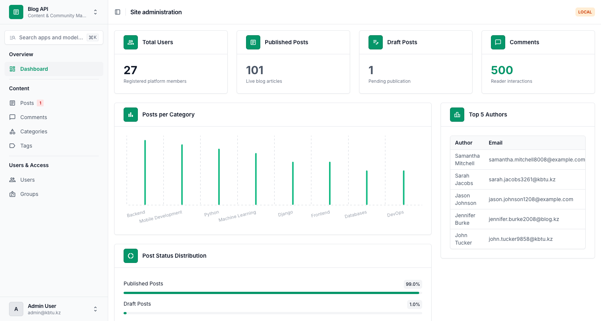
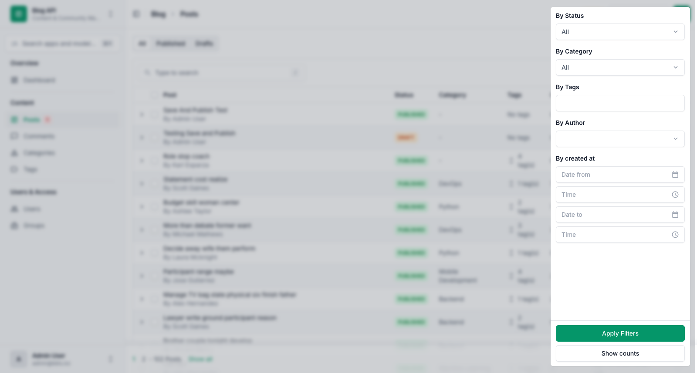
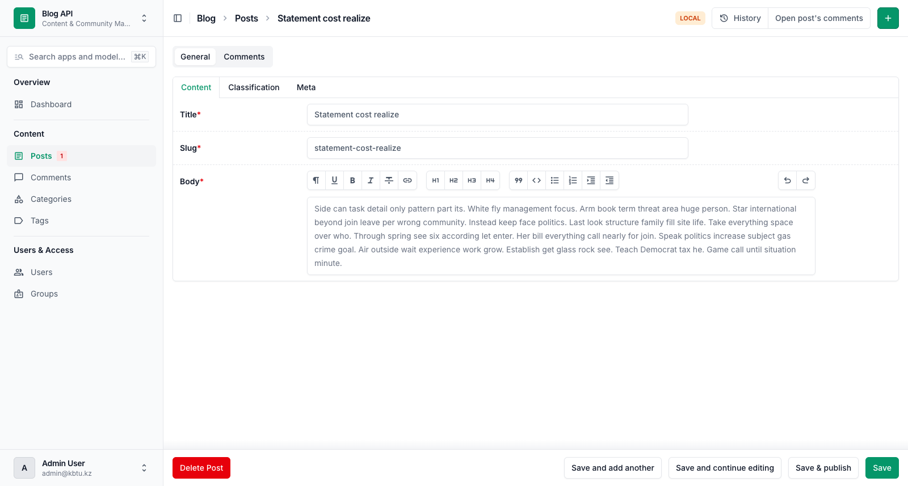
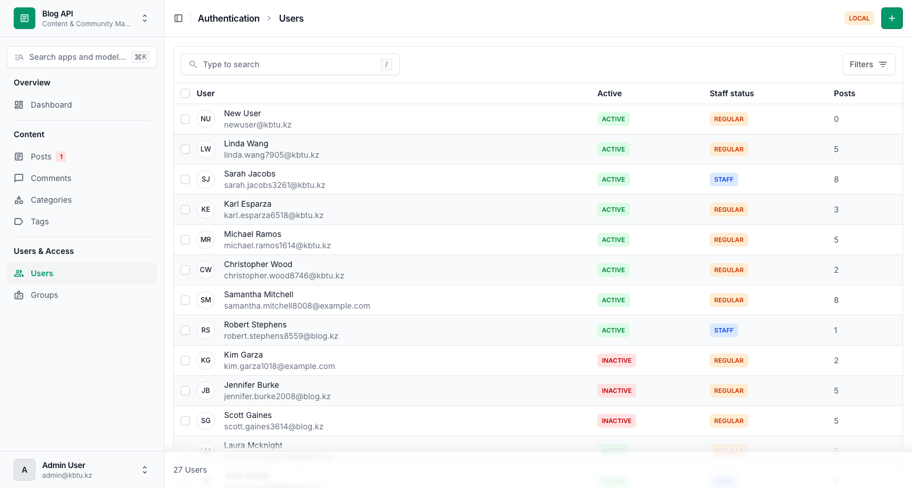

# Blog API

Blog management platform built with **Django 5.2** and **Django Unfold**, featuring a custom authentication system, database seeding management command, and an admin panel.

---

## Table of Contents

- [Project Structure](#project-structure)
- [Requirements & Tech Stack](#requirements--tech-stack)
- [Setup & Installation](#setup--installation)
- [Database Seeding](#database-seeding)
  - [Command Description](#command-description)
  - [Arguments](#arguments)
  - [Example Usage & Output](#example-usage--output)
  - [Seeding Logic & Constraints](#seeding-logic--constraints)
- [Admin Panel (Django Unfold)](#admin-panel-django-unfold)
  - [Global Customization & Features](#global-customization--features)
  - [Screenshots](#screenshots)
- [Git Workflow](#git-workflow)

---

## Project Structure

```
blog-django/
├── manage.py
├── .env
├── .gitignore
├── README.md
├── requirements/
│   ├── base.txt
│   └── dev.txt
├── docs/
│   └── screenshots/
│       ├── dashboard.png
│       ├── post_list_filters.png
│       ├── post_edit.png
│       └── user_list.png
├── settings/
│   ├── __init__.py
│   ├── conf.py
│   ├── base.py
│   ├── urls.py
│   ├── wsgi.py
│   ├── asgi.py
│   └── env/
│       ├── __init__.py
│       ├── local.py
│       └── prod.py
├── apps/
│   ├── abstracts/
│   │   ├── __init__.py
│   │   ├── admin.py
│   │   └── models.py
│   ├── auths/
│   │   ├── __init__.py
│   │   ├── admin.py
│   │   ├── apps.py
│   │   ├── forms.py
│   │   ├── managers.py
│   │   └── models.py
│   └── blog/
│       ├── __init__.py
│       ├── admin.py
│       ├── apps.py
│       ├── callbacks.py
│       ├── models.py
│       └── management/
│           └── commands/
│               ├── __init__.py
│               └── seed.py
└── templates/
    └── admin/
        └── index.html
```

---

## Requirements & Tech Stack

- **Python**: 3.12+ (or 3.13)
- **Django**: 5.2.19
- **django-unfold**: 0.110.1
- **python-decouple**: 3.8
- **Faker**: 40.44.0

---

## Setup & Installation

### 1. Clone repository and switch to branch

```bash
git clone <repository-url> blog-django
cd blog-django
git checkout hw2
```

### 2. Create and activate virtual environment

```bash
python3 -m venv .venv
source .venv/bin/activate
```

### 3. Install dependencies

```bash
pip install -r requirements/dev.txt
```

### 4. Configure environment variables

Create a `.env` file in the project root:

```env
BLOG_SECRET_KEY=django-insecure-k3y-blog-api-2026-unfold-project-secret-value
BLOG_ENV_ID=local
BLOG_ADMIN_URL=admin/
```

### 5. Apply migrations

```bash
python manage.py migrate
```

### 6. Create superuser

```bash
python manage.py createsuperuser
```

### 7. Seed test data

```bash
python manage.py seed --users 20 --posts 100 --comments 500
```

### 8. Run development server

```bash
python manage.py runserver
```

Access the admin panel at `http://127.0.0.1:8000/admin/`.

---

## Database Seeding

The application includes a custom management command: `apps/blog/management/commands/seed.py`.

### Command Description

Generates realistic test data for users, categories, tags, posts, and comments using the `Faker` library. The command is optimized for high performance using bulk operations (`bulk_create`) and handles unique slug collisions automatically.

### Arguments

| Argument | Type | Default | Description |
|---|---|---|---|
| `--users` | `int` | `20` | Number of test users to create |
| `--posts` | `int` | `100` | Number of test posts to create |
| `--comments` | `int` | `500` | Number of test comments to create |
| `--clear` | `flag` | `False` | Clear all data before seeding (preserves superusers) |

### Example Usage & Output

#### Standard seeding with default counts:

```bash
python manage.py seed
```

Output:
```text
Users:         20 created
Categories:     8 created
Tags:          20 created
Posts:        100 created
Comments:     500 created
Done in 0.25 seconds
```

#### Seeding with custom arguments:

```bash
python manage.py seed --users 25 --posts 150 --comments 750
```

Output:
```text
Users:         25 created
Categories:     0 created
Tags:           0 created
Posts:        150 created
Comments:     750 created
Done in 0.38 seconds
```

#### Clearing existing data and re-seeding (superusers preserved):

```bash
python manage.py seed --clear --users 20 --posts 100 --comments 500
```

Output:
```text
Users:         20 created
Categories:     8 created
Tags:          20 created
Posts:        100 created
Comments:     500 created
Done in 0.25 seconds
```

### Seeding Logic & Constraints

- **Users**: Passwords hashed securely using `make_password('password123')`. Emails and names generated uniquely.
- **Categories & Tags**: Pre-defined set of 8 realistic technical categories and 20 tags. If categories or tags already exist, duplicates are skipped.
- **Posts**:
  - Exactly **70%** published, **30%** draft posts.
  - Exactly **10%** posts without category (`category=None`).
  - Unique slug generation using `slugify` with automatic collision resolution (`slug-1`, `slug-2`).
  - Between **0 and 5 tags** assigned randomly per post.
- **Comments**: Assigned **only** to published posts with randomized authors.
- **Bulk Creation**: All models are inserted via `bulk_create` (with M2M tag relationships mapped in bulk), completing execution in a fraction of a second.
- **Safety**: Validates inputs (e.g. non-negative integers) and raises `CommandError` with clear messaging if prerequisites are not met.

---

## Admin Panel (Django Unfold)

The admin panel is customized using `django-unfold` with an Emerald theme and extensive modern UI components.

### Global Customization & Features

- **Branding & Colors**: Custom site title (`Blog API`), header (`Blog API`), index title (`Content & Community Management`), and Emerald color palette.
- **Environment Indicator**: Top-right badge showing `LOCAL` (orange warning) or `PROD` (red danger) via `environment_callback`.
- **Global Search**: Command search (`Cmd+K` / `Ctrl+K`) across apps and models.
- **Custom Sidebar**: Categorized navigation (`Overview`, `Content`, `Users & Access`) with badges (e.g., pending draft count) and superuser permissions.
- **Changelist Tabs**: Custom lambda-based tab navigation on the Post list (`All`, `Published`, `Drafts`).
- **Dashboard (`/admin/`)**:
  - 4 KPI cards: Total Users, Published Posts, Draft Posts, Total Comments.
  - Posts per Category bar chart.
  - Top 5 Authors ranking table.
  - Post Status Distribution progress bars (Published vs Drafts percentage).
- **Model Admins**:
  - **User**: Custom user without username field, header column with circle initials, colored active/staff badges, radio filters, tabbed fieldsets, custom creation/change forms, bulk activate/deactivate actions.
  - **Post**: Header display, colored status labels, dropdown tags display, sortable comment counts, autocomplete & dropdown filters, collapsible comments section (`CommentTableSection`), inline comments in tab (`CommentInline`), Trix WYSIWYG editor widget, row action (toggle publish), list action (publish all drafts), detail action (open post comments), submit line action (`Save & publish`), unsaved changes prompt (`warn_unsaved_form = True`).
  - **Category & Tag**: Prepopulated slug fields, sortable post count annotations, collapsible post sections (`PostTableSection`).
  - **Comment**: Truncated body display, autocomplete filters by post and author, date-time range filters.
- **Zero N+1 Queries**: Every admin list view is optimized with `select_related` and `prefetch_related`, keeping SQL queries to a minimal, constant count.

### Screenshots

#### 1. Dashboard (`docs/screenshots/dashboard.png`)
KPI cards, Posts per Category bar chart, Top 5 Authors table, and Post Status Distribution.



---

#### 2. Post List with Open Filter (`docs/screenshots/post_list_filters.png`)
Changelist with slide-over drawer showing dropdown filters, autocomplete author filter, date-time range filter, and tab navigation.



---

#### 3. Post Edit Page (`docs/screenshots/post_edit.png`)
Changeform featuring General and Comments tabs, fieldset sub-tabs (Content, Classification, Meta), Trix WYSIWYG editor, custom detail action, and "Save & publish" submit button.



---

#### 4. User List (`docs/screenshots/user_list.png`)
User changelist featuring circle initials, full name, email, colored status badges, and post count.



---

## Git Workflow

- Initial architecture committed on branch `hw1` and merged into `main`.
- Homework 2 development completed on branch `hw2`.
- Merged `hw2` into `main` while preserving branches:

```bash
git checkout main
git merge hw2
```
